

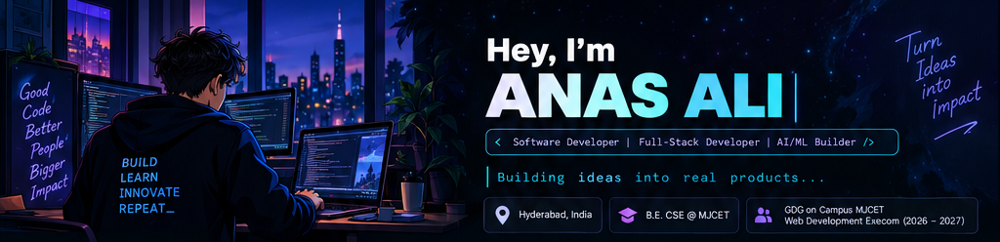

 

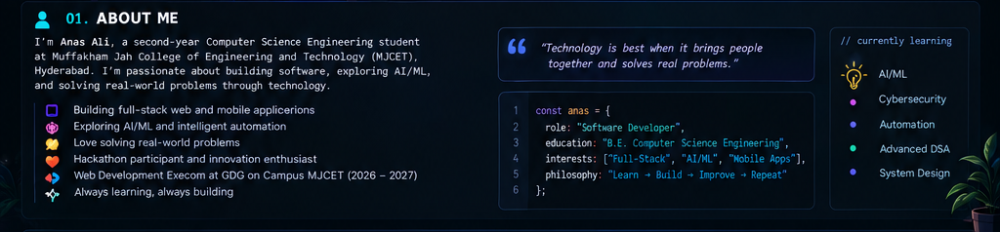

 

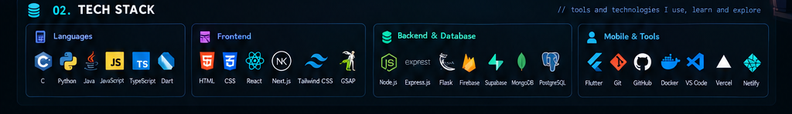

 

<a href="https://github.com/alianassyed84-sys?tab=repositories">
  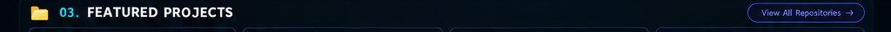
</a>

<table border="0" cellpadding="0" cellspacing="4" width="100%">
  <tr>
    <td width="25%" align="center" valign="top">
      <a href="https://github.com/alianassyed84-sys/fixnow">
        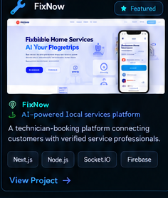
      </a>
    </td>
    <td width="25%" align="center" valign="top">
      <a href="https://github.com/alianassyed84-sys/rebookindiafinal">
        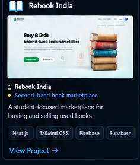
      </a>
    </td>
    <td width="25%" align="center" valign="top">
      <a href="https://github.com/alianassyed84-sys/pixel-technologies">
        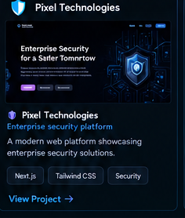
      </a>
    </td>
    <td width="25%" align="center" valign="top">
      <a href="https://sanasaliportfolio.netlify.app">
        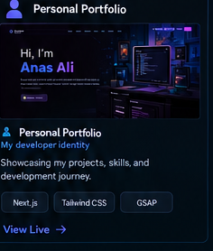
      </a>
    </td>
  </tr>
  <tr>
    <td width="25%" align="center" valign="top">
      <a href="https://github.com/alianassyed84-sys/GlassBox">
        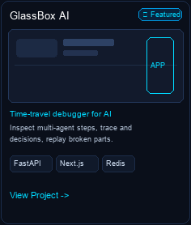
      </a>
    </td>
    <td width="25%" align="center" valign="top">
      <a href="https://github.com/alianassyed84-sys/educore-lms-mobile-app">
        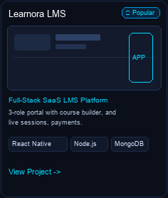
      </a>
    </td>
    <td width="25%" align="center" valign="top">
      <a href="https://github.com/alianassyed84-sys/FLEETBUSAI">
        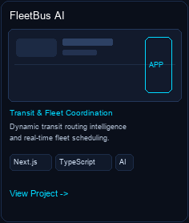
      </a>
    </td>
    <td width="25%" align="center" valign="top">
      <a href="https://github.com/alianassyed84-sys/AR-LENS">
        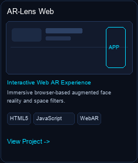
      </a>
    </td>
  </tr>
</table>

 

  
  &nbsp; <code>// real data from my GitHub profile</code>

  

  

 

  
  &nbsp; <code>// keep the graph green!</code>

<picture>
  <source media="(prefers-color-scheme: dark)" srcset="https://raw.githubusercontent.com/alianassyed84-sys/alianassyed84-sys/output/github-contribution-grid-snake-dark.svg">
  <source media="(prefers-color-scheme: light)" srcset="https://raw.githubusercontent.com/alianassyed84-sys/alianassyed84-sys/output/github-contribution-grid-snake.svg">
  
</picture>

 
<i>🐍 Eating contributions one commit at a time...</i>

 

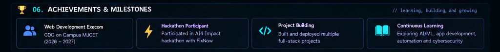

 

  

<a href="https://github.com/alianassyed84-sys">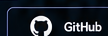</a>
&nbsp;&nbsp;&nbsp;
<a href="https://linkedin.com/in/syed-anas-ali-861340384">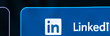</a>
&nbsp;&nbsp;&nbsp;
<a href="https://sanasaliportfolio.netlify.app">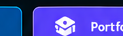</a>
&nbsp;&nbsp;&nbsp;
<a href="mailto:syedanasali650@gmail.com">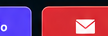</a>

  

<blockquote><i>“Open to collaborations, interesting projects, tech discussions, and opportunities to build something meaningful together.”</i></blockquote>

<b>Learn. Build. Innovate. Repeat. 🚀</b>

  

